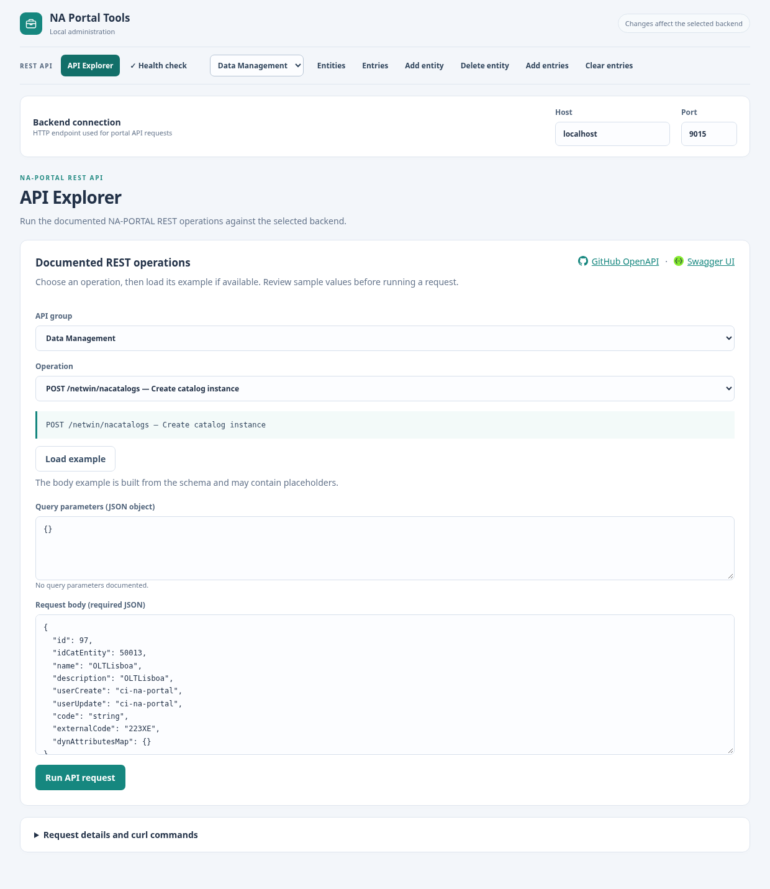
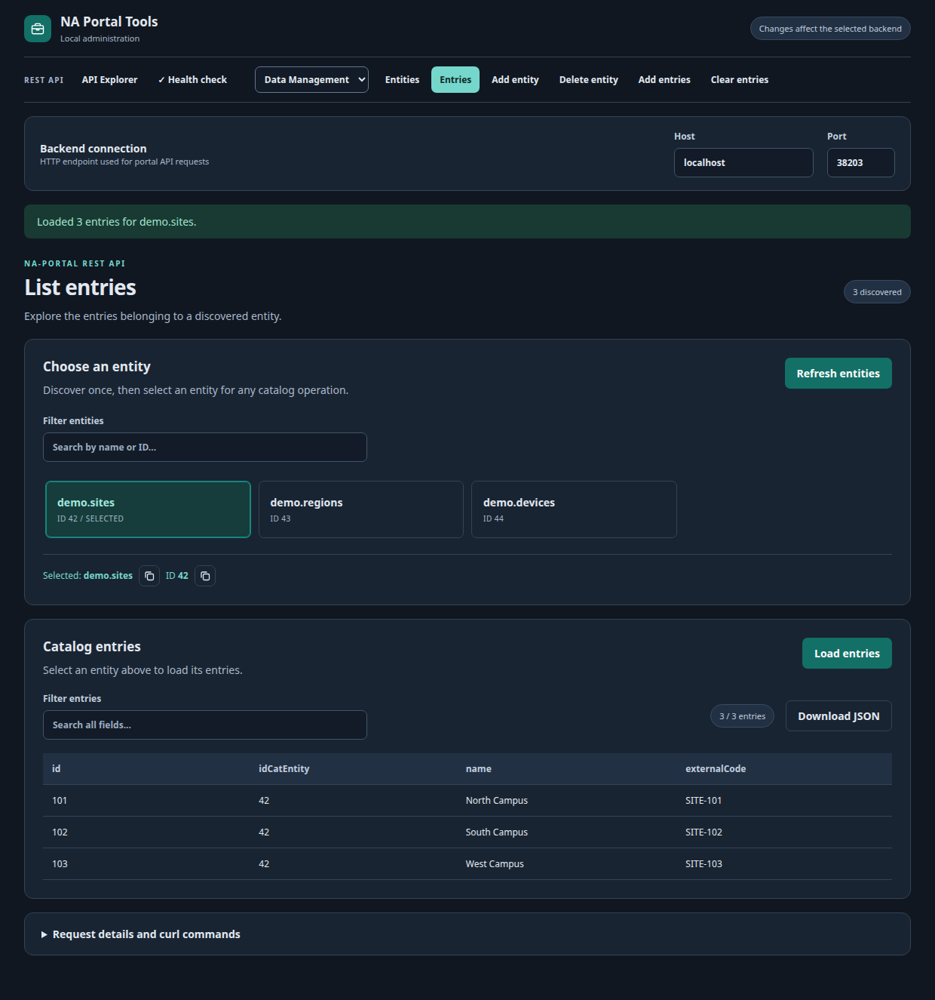

# NA Portal Tools

NA Portal Tools is a local web interface for managing catalogs and exploring
the NA-PORTAL REST 6.0.0 API. The web app uses only the Python 3.9+ standard
library.

## Screenshots

**API Explorer (light theme)** — a request body populated with **Load example**.



**Data Management (dark theme)** — browsing catalog entries with demo data.



## Run the web app

```sh
python3 web_ui.py
```

Open **http://127.0.0.1:8080/**. Use `--port 8081` to choose another web UI
port. The separate backend connection defaults to `localhost:9015`; change
it in the connection bar to match your deployment. Stop the server with Ctrl+C.
The web app automatically follows your system's light or dark appearance.
After updating the project, restart `web_ui.py` and reload the browser so the
Python server and frontend use the same version.

## API Explorer

The Explorer lists 47 operations across Health Check, MPT, GO, and Data
Management. Enter path values, query parameters as a JSON object, and a JSON
body where applicable. Non-GET requests require confirmation. Only operations
in `web/api_operations.json` are available in the Explorer.

The Explorer uses the [GitHub OpenAPI specification at `3cb5570`](https://github.com/AlticeLabsProjects/na-portal/blob/3cb5570ac61c72de338c745a1cb5448ac76a5773/doc/swagger/na-portal-rest-api-doc.json),
not the hosted [Swagger UI](http://nacommons-test-bed.c.ptin.corppt.com:70/?urls.primaryName=na-portal-rest)
operation list. The Explorer links to both Swagger UI and the
[GitHub spec on `main`](https://github.com/AlticeLabsProjects/na-portal/blob/main/doc/swagger/na-portal-rest-api-doc.json).
**Load example** fills the request editors without sending anything.
It uses documented examples where available and
builds sample request bodies from schemas when no body example is provided.
Review sample values and replace placeholders before sending. The Explorer
checks that documented required bodies are present, but does not validate
payloads against the full schema.

To refresh the local metadata, download the OpenAPI JSON from the intended
GitHub revision and run `python3 tools/generate_api_operations.py /path/to/na-portal-rest-api-doc.json`.

## Data Management workflows

Use the API group dropdown in the top bar to switch workflow groups. Data
Management opens the catalog tools. GO and MPT show **Coming soon** in place of
workflow buttons; their documented operations remain available in API Explorer.
Open the backend health page from the separate **Health check** menu button.

The shortcuts use deployed routes that may differ from the OpenAPI reference:
`GET /netwin/nacatalogs/entities-tree/6`, entry listing via
`GET /netwin/nacatalogs?$filter=idCatEntity eq …`, entry creation via
`POST /netwin/nacatalogs`, and entity-scoped entry deletion via
`DELETE /netwin/na/catalog/{idCatEntity}`. Entity creation and deletion use
`/netwin/catalog-entities`. The shortcut discovers entities through the same
entity-tree endpoint used by the legacy scripts; the API Explorer also exposes
the documented `GET /netwin/catalog-entities` collection route.

Discover entities and select one to use catalog shortcuts. Use the copy icon
next to the selected entity's name or ID to copy that value. Opening **Entries**
with an entity selected, or selecting one on that page, loads its entries.
Changing the backend clears discovered data. Entries can be filtered and
downloaded as JSON.

Entity and entry insertion accept pasted JSON or browser-uploaded JSON files.
The selected entity ID replaces `idCatEntity` and existing entry IDs are
removed on entry insertion. Insertion requires a preview confirmation.
Deletion requires typing the selected entity name. Batch insertion stops on the
first failure and reports how many entries succeeded; it is not transactional.
Check current entries before retrying a partially completed batch.

## Request details

Expand **Request details and curl commands** to see each backend HTTP request,
its status, elapsed time, response headers, and body preview. The copy icon
above the curl editor copies its current contents, including edits. Editing or
copying a command does not execute it. Commands are quoted for a POSIX shell.
**Clear console** clears the in-memory history. Requests, commands, and
responses may contain sensitive catalog values; review them before sharing.

## Operational boundaries

This is a local administration tool, not a multi-user hosted application. It
binds only to `127.0.0.1`, requires same-origin token-protected action requests,
and does not enable CORS. Do not expose it through a public reverse proxy or use
it on an untrusted shared machine. Anyone with local access can use its portal
administration privileges. Portal requests use HTTP, matching the API server
configuration; use a trusted network. Downloads and JSON previews can contain
sensitive catalog fields.

Web console HTTP requests use 30-second timeouts and report backend errors.
The **Health Check** page calls `GET /health` and accepts an empty successful
response. Its separate **Check connectivity** button runs a TCP connection
probe with a 5-second socket timeout; a reachable port does not mean the HTTP
health check passed. API Explorer also accepts empty successful GET responses
when the reference documents them. Generated curl commands use curl's own
proxy and timeout defaults.

## Legacy CLI

The CLI is separate from the web app and requires `requests`:

```sh
python3 -m pip install -r requirements.txt
python3 portal_scripts.py
```

The interactive CLI uses `localhost:9015`. Its translation option previews
translated entries without inserting them. Run it from a working directory
where `beforeTranslate/` and `afterTranslate/` can be cleared; it requires the
translator installed at `/opt/ptin/na-portal/bin/na-portal-catalog-template-translator/translate.sh`.
These generated directories are ignored by Git because they may contain
sensitive catalog data.
The files under `opt/alticelabs/` are deployment assets, not a standalone
translator. CLI restart is host-local and requires a working init script; the
web app does not expose it.

For noninteractive entity creation, run
`python3 create_new_catalog.py HOST DIRECTORY FILE_STEM` (port `9015`; omit
`.json` from `FILE_STEM`).

Use `snake_case` for Python module and script filenames. Keep conventional
filenames such as `README.md` and paths required by external deployment tools.

## Tests

Run from the project root with Python and `curl` installed:

```sh
python3 -m unittest discover -s tests -v
```

Tests use a fake portal and do not modify a live backend.
